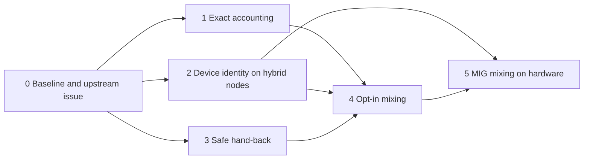

# Plan: native Slurm jobs and bridge Pods on one node, down to MIG instances

Status: draft for discussion. Baseline: upstream `main` at `60d4e94`
(2026-11-11). This file lives on a side branch of the fork and is not meant for
upstream.

## Goal

A hybrid node (kubelet and `slurmd` on one host) runs native Slurm jobs and
slurm-bridge Pods **at the same time**. Slurm is the only allocator. Each
workload is confined to the cores, memory and devices Slurm gave it. On a GPU
split with MIG, a native job and a Pod can each hold their own MIG instances of
the same physical GPU.

Starting a Kubernetes workload must never require emptying the node of Slurm
jobs, and the reverse.

## Approach: no new mode, only removed obstacles

The first attempt (`docs/coresidency.md` on the old fork `main`, commit
`e21914e`) added a mode switch, `nodeSharing: coResident`, plus batch
placeholders with an epilog. It worked in kind, but it was one large change
that redefined defaults, which is hard to upstream.

This plan instead treats the goal as the sum of small gaps in what upstream
already ships. Each contribution must:

1. be useful to upstream on its own, even if nothing after it lands;
1. leave default behaviour unchanged;
1. fit in one reviewable pull request with unit tests, and e2e where kind can
   prove it;
1. be preceded by an upstream issue when it changes behaviour or adds
   configuration (CONTRIBUTING asks for this for larger features).

## What upstream already provides

Much of the old fork's groundwork now exists upstream:

| Capability                              | State upstream                                                                                           |
| --------------------------------------- | -------------------------------------------------------------------------------------------------------- |
| Hybrid nodes                            | Supported, with slurm-operator DaemonSet `slurmd` or host-installed `slurmd`                             |
| Several Pods sharing a node             | `slurmjob.slinky.slurm.net/exclusive: "false"`, submitted as `Shared=mcs` with `schedulerConfig.mcsLabel` |
| Exact device identity for Pods          | DRA indexed GRES: Slurm picks GRES indices, the bridge writes the ResourceClaim for those devices        |
| MIG instances as schedulable devices    | Static MIG through one device profile per MIG size (`docs/nvidia-gpu-dra-mig.md`)                        |
| Pods pinned to Slurm's cores            | CPU DRA (`dra.cpu`, core bitmap), non-exclusive only                                                     |
| CPU/GPU/NIC locality                    | NUMA alignment                                                                                           |
| Hybrid GRES sanity check                | `SlinkySlurmGRESCompatible` condition and `slurm_bridge_gres_compatible` feature                         |
| Pod-first release                       | Allocation is kept until bound Pods are terminal                                                         |

So on a hybrid node, Slurm already accounts for native jobs and bridge jobs in
one inventory. What is missing is permission to mix them and the guarantees
that make mixing safe.

## Gaps between upstream and the goal

| ID | Gap                                                                                                                                                                                                                                           | Evidence                                                              |
| -- | --------------------------------------------------------------------------------------------------------------------------------------------------------------------------------------------------------------------------------------------- | --------------------------------------------------------------------- |
| G1 | **Policy.** Non-exclusive bridge jobs always carry the bridge MCS label, and `mcsLabel` may not be empty. Native jobs with another label cannot share the node. The docs forbid simultaneous use.                                               | `sharedFromExclusiveAnnotation`, `config.go` validation, `docs/config.md` |
| G2 | **Memory accounting.** Pod memory is rounded *down* to MiB for the Slurm job, so a Pod can exceed its reservation slightly. Limits are not required to equal the reservation.                                                                    | `GetMemoryFromQuantity`                                               |
| G3 | **CPU confinement.** Only CPU DRA pins a Pod to Slurm's cores. Pods with plain `cpu` requests, and tolerated DaemonSets, float over every core not claimed through DRA, including cores Slurm gave to native jobs.                              | `docs/workload.md`, CPU DRA                                           |
| G4 | **Capacity agreement.** Nothing checks that what Slurm can hand out fits inside kubelet's allocatable after system Pods. A Pod can be allocated by Slurm and then fail to start.                                                                | absent upstream; was `SlinkySlurmResourcesFit` in the old fork        |
| G5 | **Device identity on hybrid nodes.** The compatibility check compares GRES names, types and counts only, not device order or device files. With time-sharing a wrong order costs locality. With simultaneous use it hands one physical device to a native job and a Pod. | `docs/config.md`, hybrid nodes                                        |
| G6 | **Legacy GPU path.** `nvidia.com/gpu` through the device plugin reserves a count in Slurm while kubelet picks the device. Unsafe on any shared node.                                                                                            | `docs/workload.md`, legacy GPU device plugins                         |
| G7 | **Slurm-first release.** When Slurm ends an external job first (`scancel`, time limit, preemption), its cores and devices are free immediately while the Pod is still running. Upstream documents this as an operator duty.                     | `docs/config.md`, last paragraph of hybrid workload isolation         |
| G8 | **MIG on the native side.** Native jobs must see the same MIG instances under the same GRES type names and indices as the bridge, with device files that `ConstrainDevices` can enforce. Nothing generates or verifies this.                     | `docs/nvidia-gpu-dra-mig.md` covers the bridge side only              |
| G9 | **Proof.** kind shares one kernel and runs `slurmd` in a Pod. It can prove scheduling and accounting, not isolation.                                                                                                                             | lesson from the first attempt                                         |

G2 to G7 are not specific to native jobs. They already weaken today's
non-exclusive sharing between Pods and today's time-shared hybrid nodes. That
is what makes them upstreamable one at a time.

## Phases

Phases 1, 2 and 3 are independent and can progress in parallel. Phase 4 is
small once they exist.

### Phase 0: baseline, without changing upstream code

- **0.1 Upstream issue.** State the goal, list G1 to G9, propose this sequence,
  and ask the two questions that shape everything: how mixing should be
  permitted (see Decision A) and how Slurm-first release should be handled
  (Decision B).
- **0.2 Configuration-only experiment.** On stock upstream, submit a native job
  that joins the bridge's MCS label and a Pod with `exclusive: "false"` to the
  same hybrid node. `docs/config.md` warns that a native user "can deliberately
  join the bridge's MCS category", which suggests mixing is already reachable
  by configuration. Repeat with MIG profiles on real hardware. Record what
  works and what breaks per gap. This turns the gap table from reasoning into
  observations.
- **0.3 Fork hygiene.** Keep fork `main` identical to upstream. One branch per
  pull request, cut from upstream `main`. One `integration` branch that merges
  the in-flight branches for testing on real nodes. Never stack features on
  fork `main` again.

Exit: maintainer feedback on direction, and a findings table from 0.2.

### Phase 1: exact accounting (G2, G3, G4)

| PR  | Change                                                                                                                                             | Standalone value                                      |
| --- | -------------------------------------------------------------------------------------------------------------------------------------------------- | ----------------------------------------------------- |
| 1.1 | `fix`: round Pod memory up to whole MiB when sizing the Slurm job                                                                                  | Pods never exceed their Slurm reservation             |
| 1.2 | `fix`: pod-level limits for Jobs (re-check the fork branch `fix/job-pod-level-limits` against current `main`)                                      | Correct sizing                                        |
| 1.3 | `feat(node)`: node condition reporting whether Slurm's schedulable CPU and memory fit kubelet allocatable minus non-bridge Pods                    | Explains Pods stuck after allocation on any node mode |
| 1.4 | `feat(admission)`: opt-in rule that reservations are enforceable: memory limit present and equal to the reservation, CPU by limit or CPU DRA       | Honest non-exclusive sharing between Pods             |
| 1.5 | `docs`: reserved-core recipe, Slurm `CpuSpecList` equal to kubelet `reservedSystemCPUs`, and where unpinned Pods run                               | Closes the DaemonSet half of G3                       |

Open in G3: with CPU DRA, the shared pool for unpinned containers is "all cores
not claimed through DRA". The CPU driver does not know which cores Slurm gave
to native jobs. Either the shared pool is limited to the reserved cores, or the
bridge feeds native allocations to the driver. Needs a design note before 1.5.

### Phase 2: device identity on hybrid nodes (G5, G6, G8)

| PR  | Change                                                                                                                                                         | Standalone value                                         |
| --- | -------------------------------------------------------------------------------------------------------------------------------------------------------------- | -------------------------------------------------------- |
| 2.1 | `feat(node)`: emit the complete required `gres.conf` per node from the DRA inventory, in index order, including MIG entries, not only name, type and count      | Removes hand-written ordering, today's NUMA pitfall      |
| 2.2 | `feat(node)`: verify order and device identity on hybrid nodes and withhold `slurm_bridge_gres_compatible` on mismatch                                          | Turns a documented caveat into a checked invariant       |
| 2.3 | `docs`: MIG on hybrid nodes. Type naming shared by `gres.conf` and device profiles, device files for `ConstrainDevices`, layout-change procedure with native jobs | Completes the MIG guide for hybrid nodes                 |
| 2.4 | `test(e2e)`: MIG-shaped devices in the kind hybrid profile, several profiles sharing the `gpu` index space                                                      | Regression cover for `firstIndex` mapping                |
| 2.5 | `feat(admission)`: way to refuse the legacy device-plugin GPU path per node or partition                                                                        | Sites that want exact identity can enforce it            |

2.2 is the hardest item in the plan. The Slurm REST node object exposes GRES
strings, not the device file behind each index, so the bridge cannot verify
identity from the controller alone. Candidates: a node-local check that
compares `slurmd`'s view with the ResourceSlice identifiers and reports
through a node annotation; or making 2.1 the single source of truth and
checking a hash of the applied `gres.conf`. Decide in the upstream issue.

### Phase 3: safe hand-back when Slurm ends the job first (G7)

| PR  | Change                                                                                                   | Standalone value                               |
| --- | -------------------------------------------------------------------------------------------------------- | ---------------------------------------------- |
| 3.1 | Design issue with the options of Decision B                                                              | Upstream already lists this as an operator duty |
| 3.2 | Implement the agreed mechanism behind configuration                                                      | Protects time-shared hybrid nodes too          |
| 3.3 | `test(e2e)`: native work does not start on resources of a Pod that is still stopping, in both orders     | Regression cover                               |

### Phase 4: opt-in mixing (G1)

| PR  | Change                                                                                                                                                              | Depends on |
| --- | ------------------------------------------------------------------------------------------------------------------------------------------------------------------- | ---------- |
| 4.1 | `docs` and `test(e2e)`: supported recipe for native jobs and Pods on one node, the inverse of today's "Hybrid MCS isolation" test                                   | Phase 0    |
| 4.2 | `feat`: guardrails where mixing is enabled. Warn or refuse on partition oversubscription, missing memory scheduling, legacy GPU path, unenforceable reservations     | 1.4, 2.5   |
| 4.3 | `feat`, only if maintainers want it explicit: first-class configuration for mixing instead of the MCS recipe                                                         | Decision A |

Required Slurm configuration to document in 4.1, carried over from the first
attempt: `SelectTypeParameters=CR_Core_Memory`, `TaskPlugin=task/cgroup` with
`ConstrainCores`, `ConstrainRAMSpace` and `ConstrainDevices`, partition
`OverSubscribe=NO`, kubelet CPU manager policy `none`.

### Phase 5: MIG mixing, proven on hardware (G8, G9)

- Validation matrix on real GPU nodes: native job and Pod on different MIG
  instances of one GPU, in both start orders; exhaustion of one MIG size while
  others are free; mixed full-GPU and MIG nodes; Slurm-first and Pod-first
  release; layout change with drain.
- Isolation checks that kind cannot do: cores, memory, device cgroups, and
  that each side sees only its MIG UUIDs.
- `docs`: add simultaneous use to the MIG guide and lift the "never at the same
  time" statements where the guarantees hold.

Out of scope for now: dynamic MIG (instances created on demand) and changing a
MIG layout without draining the node.

## Decisions to settle early

**A. How mixing is permitted.**

1. *MCS join.* Native jobs in the mixed partition get the bridge's MCS label,
   for example through a `job_submit` plugin. No bridge change. Fits upstream's
   model, where the label is the sharing boundary. To verify in 0.2.
1. *No MCS.* The bridge can submit non-exclusive jobs without `Shared=mcs`, as
   the old fork did. Needs a bridge change and reopens what MCS protects.
1. *Per-partition setting.* Explicit, but the largest API surface.

Recommendation: start with 1, because it needs no upstream agreement, and let
maintainers choose whether 4.3 is wanted.

**B. Slurm-first release.**

1. *Batch placeholder with epilog hold*, as in the old fork. Proven in kind.
   Costs: the whole node waits, `slurmd` needs container runtime access, the
   job user must exist on the node.
1. *Prevent it.* Make sure Slurm does not end bridge jobs before the Pod: no
   implicit time limit, preemption and cancellation routed through Pod
   deletion. Smaller, but does not cover an administrator's `scancel`.
1. *React.* The bridge blocks the node the moment it sees an ended job with a
   live Pod. Leaves a window as long as detection takes.

Recommendation: propose 2 as the default path and 1 as the strict option. Ask
upstream before building either.

## Assumptions not yet verified

- That a native job can join the bridge MCS label under `mcs/label` with
  `ondemand,ondemandselect` and then share a node with a bridge job. Inferred
  from `docs/config.md`, not tested.
- Which GRES type names Slurm's NVML autodetection gives MIG instances, and
  whether device profile names can be chosen to match them.
- Which identifying attributes the NVIDIA DRA driver publishes per MIG device
  beyond `type`, `profile` and `uuid`, and whether they map to device files.
- Whether the NVML mock used in kind can present MIG devices.
- Whether the old fork's fixes (`fix/job-pod-level-limits`, node controller
  requeue key `93f332b`) still apply to current upstream.

## Done means

- Upstream documentation no longer says native and bridge workloads must not
  run on one node at the same time, for nodes that meet stated requirements.
- A native job and a Pod hold different MIG instances of one GPU on real
  hardware, and each is confined to its own cores, memory and devices.
- A node whose Slurm and DRA views disagree is excluded automatically.
- The fork carries no patches that upstream does not have.
